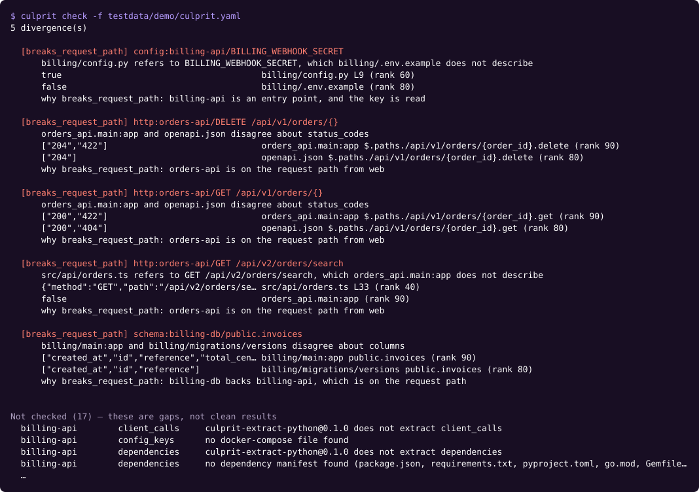
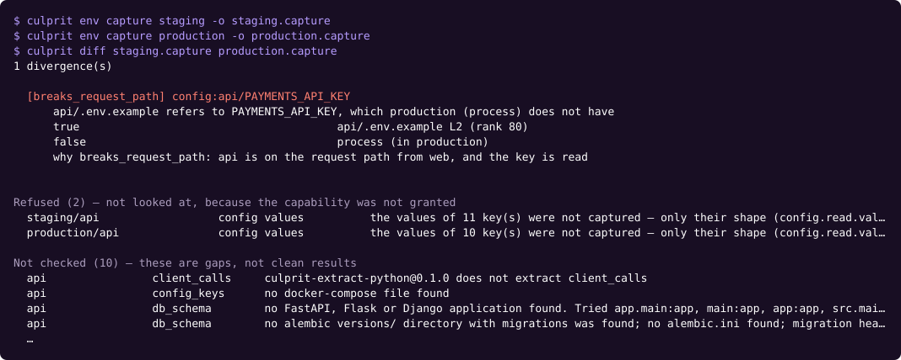
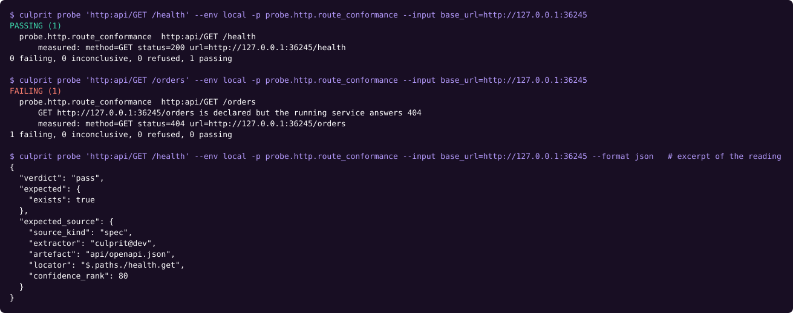
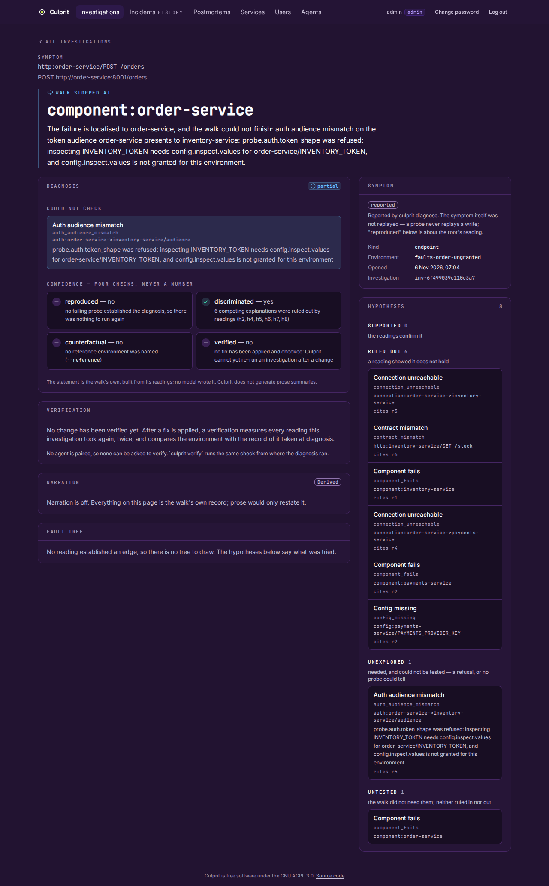
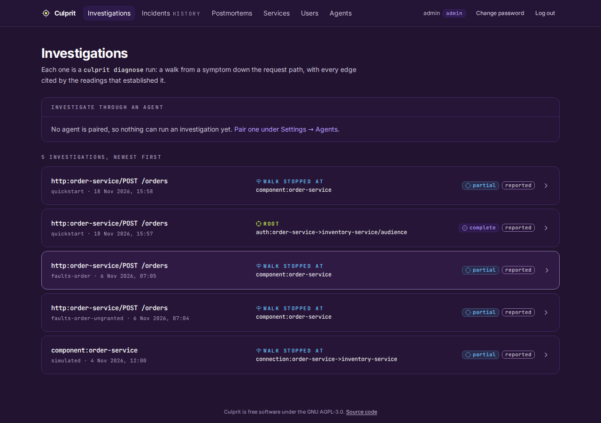
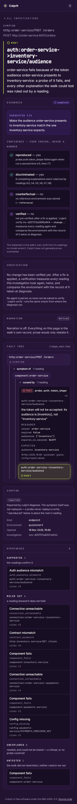
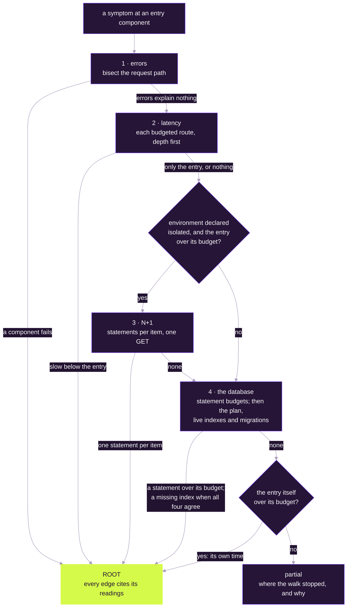

<picture>
  <source media="(prefers-color-scheme: dark)" srcset="docs/brand/hero-dark.png">
  <source media="(prefers-color-scheme: light)" srcset="docs/brand/hero-light.png">
  
</picture>

[Guide](docs/GUIDE.md) · [Quickstart](#quickstart) · [Limits](docs/LIMITS.md) · [Probes](docs/PROBES.md) · [Permissions](docs/PERMISSIONS.md) · [Install](docs/INSTALL.md) · [Security](docs/SECURITY.md)

# Culprit

**Culprit finds the places where your system disagrees with itself.**

## The problem

Most production faults are not bugs in one service. They are disagreements
between things that were each correct on their own: a route the frontend
calls that the API no longer serves, a column the ORM maps that a migration
never created, a key the code reads that production does not set. Each half
looks fine in review. The fault is the gap between them, and nobody owns the
gap.

Culprit reads what your system says it does, what each environment is set up
to do, and what actually happens when you ask it — and reports where those
disagree. It is for small teams running a handful of services without a
dedicated SRE function: the people who currently find these faults by
reading logs after a customer does.

What you get is a list of contradictions, each with both sides' evidence and
a severity computed from your own service graph, in CI before you deploy,
with no agent, no telemetry and no account.

## See it work

These are real runs, regenerated by `just readme-captures`
([`scripts/render_captures.py`](scripts/render_captures.py)) — nothing here is
drawn by hand.

**`culprit check`** compares everything a repository says about itself. Here
it runs on [`cli/testdata/demo`](cli/testdata/demo), a five-component system
in this tree — three services (a FastAPI service, a React frontend and a
small billing service) and the two databases behind them — with faults
planted in it:



**`culprit env capture` and `culprit diff`** read two environments and compare
them with each other and with the code. Production is missing a key the code
reads; the capture recorded the shape of every value, never the value:



**`culprit probe`** asks a running service a question and compares the answer
with what the code declares. One declared route is served and one is not; the
reading names the declaration it was measured against:



**The dashboard** shows what `culprit diagnose` found. These screenshots are
taken by the end-to-end suite (`frontend/e2e/tour.spec.ts`, `just e2e`)
against the stack `just quickstart` builds, the same run CI makes on every
pull request, so they show only what renders. The data is the quickstart's
injected fault and the fault library's recorded walks.

A complete investigation: the root is marked, every edge opens to the
readings that established it, and confidence is four checks rather than a
score.


A partial one is shown as where the walk stopped and what it could not
check — never as a root or a cause:



<p>
  
  
</p>

## What it does

| | |
|---|---|
| **Finds contradictions before deploy** | `culprit check` compares route tables, OpenAPI specs, client calls, ORM models, migrations, `.env.example` and manifests, in CI, with no network and no account. |
| **Rates them by your service graph** | Severity comes from the connections you declare in `culprit.yaml`: on the request path it is `breaks_request_path`, never a model's opinion. |
| **Compares environments safely** | `culprit env capture` reads Compose, Kubernetes or a process and records each config value as a shape, unless you grant that one key. |
| **Asks a running system** | 18 read-only probes, each asking permission before it dials anything ([`docs/PROBES.md`](docs/PROBES.md)). |
| **Walks from a symptom to a root** | `culprit diagnose` walks the connection graph and records an investigation whose every edge cites a reading. |
| **Holds the system to its budgets** | Latency, bundle size, list size and statement time are declared as budgets, never guessed, and the walk finds what breaks them. |
| **Checks that a fix fixed it** | `culprit verify` measures every reading again, twice, and says `verified` only when nothing else changed underneath. |
| **Lets a coding agent ask** | `culprit mcp` serves read-only tools over MCP; the agent changes the code, and Culprit judges the change. |

The whole list, with each feature's detail, is in [the guide](docs/GUIDE.md#key-features).

## How it works

Culprit keeps three planes of truth apart and treats disagreement between them
as the finding:

| Plane | Means | Comes from |
|---|---|---|
| **INTENT** | what the system is supposed to do | the repository: specs, route tables, migrations, `.env.example`, `culprit.yaml` |
| **CONFIGURED** | what an environment is set up to do | `culprit env capture` |
| **OBSERVED** | what actually happened when measured | `culprit probe`, and the walk |

Everything is a **fact** about a **subject**, such as
`http:orders-api/GET /api/v1/orders/{}`, with provenance and a confidence
rank. Two sources that describe the same thing produce byte-identical
subjects, so comparing them is a grouping, not a guess.

**The walk.** `culprit diagnose` asks in a fixed order, cheapest and most
fundamental first, and stops at the first question that finds a root. A
question it could not ask (a grant missing, a probe inconclusive) makes the
diagnosis partial, and it says which:



**Why no model decides.** Extraction, comparison, severity, capture, probing,
the walk and verification are deterministic. A language model appears in one
optional place, narration, which turns a settled investigation into prose and
is checked against it before it is shown; nothing reads what it writes. With
`LLM_PROVIDER=none` every command and page is complete.

The full account, with the architecture diagrams, is in
[the guide](docs/GUIDE.md#how-it-works).

## Engineering highlights

- **The determinism boundary is linked, not promised.** Only the probe
  package (with its one-file `guardedhttp`) and the agent's transport may
  link `net/http`, and a test lists every package and fails on any other: `TestTheNetworkBoundaryIsAnAllowlist` in
  [`cli/cmd/culprit/check_test.go`](cli/cmd/culprit/check_test.go). Nothing
  in the binary opens a listener (`TestNothingInTheBinaryListens`).
- **No LLM client outside narration.**
  [`scripts/check_no_llm_imports.py`](scripts/check_no_llm_imports.py) covers
  every deterministic package, in Python, Go and JavaScript, beside two
  `lint-imports` contracts.
- **One subject, three languages.** Go, Python and TypeScript build subjects
  through one function each, held together by
  [`shared/tests/subject_conformance.json`](shared/tests/subject_conformance.json).
- **A config value never appears in a report** unless you grant that key:
  `TestNoRenderedFormatCanPrintAConfigValue` in
  [`cli/internal/report/report_test.go`](cli/internal/report/report_test.go).
- **Least-privilege database roles.** A component that needs a new
  write gets a new role, never a wider one
  ([`docs/PERMISSIONS.md`](docs/PERMISSIONS.md)).
- **Every planted fault, walked and verified in CI.** `TestTheFaultLibrary`
  in [`cli/cmd/culprit/faultlib_test.go`](cli/cmd/culprit/faultlib_test.go)
  plants each fault, diagnoses it, applies its fix and verifies it, against
  [`cli/testdata/faultlib/expected.json`](cli/testdata/faultlib/expected.json).
- **Every migration runs down and up again** against a database with rows in
  it: [`scripts/check_migration_round_trip.py`](scripts/check_migration_round_trip.py).
- **This README is checked.** [`scripts/check_readme.py`](scripts/check_readme.py)
  holds its links, its probe count and its diagram colours to the tree, and
  the self-check job holds its figures to the self-check's output; the
  accuracy block below and the hero's figure are rendered from the fault
  library's results, and a test fails when either is stale.
- **Culprit checks itself.** `just self-check` runs `culprit check` on this
  repository: **no divergences, 1,753 facts across 631 subjects**, 9 gaps
  listed.

<!-- accuracy:begin -->
<!-- Rendered by `just accuracy-readme` from cli/testdata/faultlib/results.json. Do not edit by hand: CI fails if this differs. -->

## Accuracy, on faults we planted

**9 of 9 planted faults verified fixed** (100%), of 11 faults planted: 9 outcomes, 0 inconclusive beside that, and 2 partial diagnoses not counted.

**These are faults we planted, in Culprit's own three demo services, and nothing else. They are not accuracy on anyone's real system.** No outcome from a real system is counted here, because none has been recorded. A sample of 9 planted faults says the loop works on the faults it was built against; it says nothing yet about the faults it was not.

**Method.** Each fault in the library (`cli/testdata/faultlib/`) is planted in the demo stack, diagnosed by `culprit diagnose` from inside a service, its known fix is applied, and `culprit verify` measures every reading again, twice, and compares the environment with the record of it taken at diagnosis. An outcome is the verification of a **complete** diagnosis; its fault class is the subject kind of the diagnosis's root. Per class, `verified` is counted against the decided outcomes (every verdict but inconclusive), and inconclusive is reported beside it, never folded in. A `verified` outcome shows that the fix for the root the walk diagnosed was seen to fix what it saw failing; a fault diagnosed at the wrong root would be counted under that root's class, so this measures diagnosis-then-fix, not whether every diagnosis named the true cause. `GET /outcomes/accuracy` counts verifications recorded through the control plane the same way, with the same function, and says for each count whether its faults were planted or real.

| Fault class | Planted fault | Outcomes | Verified | Decided | Inconclusive |
|---|---|---|---|---|---|
| `auth` | `auth-audience` | 1 | 1 | 1 | 0 |
| `component` | `error-rate`, `latency`, `n-plus-one-shared` | 3 | 3 | 3 | 0 |
| `config` | `config` | 1 | 1 | 1 | 0 |
| `connection` | `network-partition` | 1 | 1 | 1 | 0 |
| `http` | `contract`, `n-plus-one` | 2 | 2 | 2 | 0 |
| `schema` | `missing-index` | 1 | 1 | 1 | 0 |

Not counted, because the walk's diagnosis was partial — an outcome is the verification of a complete one: `auth-audience-ungranted` (inconclusive); `latency-unbudgeted` (inconclusive).

Not counted either: the library's deliberate wrong and partial fixes, which check that verification says so rather than measure diagnosis — `wrong-fix` (not_resolved); `latency-wrong-fix` (not_resolved); `regressed` (regressed); `changed-underneath` (changed_underneath); `no-change-named` (inconclusive); `missing-index-wrong-fix` (not_resolved).

<!-- accuracy:end -->

## Quickstart

The CLI needs [Go 1.27+](https://go.dev/dl/), [`just`](https://github.com/casey/just),
[`uv`](https://docs.astral.sh/uv/) and [Node.js 22](https://nodejs.org/):

```bash
git clone https://github.com/Josh-Heath123/Culprit.git culprit
cd culprit
just cli-build                       # -> cli/bin/culprit
(cd extractors/node && npm ci)       # the Node extractor's one dependency
export PATH="$PWD/cli/bin:$PATH"
cd cli && culprit check -f testdata/demo/culprit.yaml
```

The control plane and dashboard need only [Docker](https://docs.docker.com/get-docker/)
and `just`:

```bash
just quickstart
```

It builds every image, generates every secret, starts the stack with the
demo services, plants a fault (order-service's token for inventory-service,
minted for the wrong audience), runs `culprit diagnose` inside order-service,
and prints the investigation's address. No API key of any kind is needed.
The tutorial, end to end, is in [the guide](docs/GUIDE.md#usage-one-project-end-to-end);
a real host is [`docs/INSTALL.md`](docs/INSTALL.md).

## Status

From the plans of record:

- **Done.** The diagnostic engine, Phases 26–35
  ([`docs/DIAGNOSTIC_PLAN.md`](docs/DIAGNOSTIC_PLAN.md)): the three planes,
  the system model, `check`, capture and `diff`, probes, the walk, the agent,
  verification, the MCP surface and narration. Performance, Phases 36–39
  ([`docs/PERFORMANCE_PLAN.md`](docs/PERFORMANCE_PLAN.md)): budgets, the
  database's statements and indexes, bundles, lists and N+1.
- **In progress.** Phase 40, the new identity
  ([`docs/DELIVERY_PLAN.md`](docs/DELIVERY_PLAN.md)): the dashboard is done;
  the repository is this change.
- **Planned.** Phase 41, one required gate on `main`; Phase 42, ownership on
  the record; Phase 43, signed commits, pinned actions and attested
  artifacts. The demonstration video, from [`docs/video/`](docs/video), linked
  here once it exists. No release binaries are published yet.

## Documentation

| | |
|---|---|
| [`docs/GUIDE.md`](docs/GUIDE.md) | every feature, how it works, installation, the tutorial, the agent surface, testing, layout |
| [`docs/LIMITS.md`](docs/LIMITS.md) | every threshold, heuristic and gap a user can hit |
| [`docs/PROBES.md`](docs/PROBES.md) | each probe, its grant and its verdicts |
| [`docs/PERMISSIONS.md`](docs/PERMISSIONS.md) | every grant and database role |
| [`docs/SECURITY.md`](docs/SECURITY.md) | what a compromised agent or control plane can and cannot do |
| [`docs/INSTALL.md`](docs/INSTALL.md), [`docs/UPGRADING.md`](docs/UPGRADING.md) | a real host, and upgrades |
| [`docs/EXTRACTOR_PROTOCOL.md`](docs/EXTRACTOR_PROTOCOL.md) | writing an extractor |
| [`docs/ARCHITECTURE.md`](docs/ARCHITECTURE.md) | the architecture, layer by layer |
| [`docs/DIAGNOSTIC_PLAN.md`](docs/DIAGNOSTIC_PLAN.md) | the decisions of record (D1–D8) and their history |

## Technology

| Role | Used |
|---|---|
| CLI and probe agent | Go 1.27, `cobra`, `yaml.v3`, `pgx`. One static binary, no cgo. |
| Extractors | Python (FastAPI, Flask and Django introspection, SQLAlchemy, Alembic, `ast`), Node (`@babel/parser`) |
| Backend | Python 3.12, FastAPI, SQLAlchemy, Alembic, `arq` jobs on Redis, managed with `uv` |
| Data | PostgreSQL 16 with TimescaleDB and pgvector, one instance, least-privilege roles |
| Frontend | React 18, Vite, TypeScript, Tailwind, shadcn/ui, TanStack Query, visx, cmdk |
| Infrastructure and checks | Docker Compose, Caddy, GitHub Actions, Trivy, pytest, `go test`, pyright, ruff, import-linter, Playwright; the full table is in [the guide](docs/GUIDE.md#technology-stack) |

## Author and licence

Built by [Joshua Heath](https://github.com/Josh-Heath123). Culprit is licensed
under the GNU AGPL 3.0 only — see [`LICENSE`](LICENSE). The extractors
(`extractors/python`, `extractors/node`) and `shared/` are Apache-2.0, so they
can run inside your project without the AGPL. [`LICENSING.md`](LICENSING.md)
maps every directory to its licence. Releases before this change were MIT and
remain available under MIT.

This repository was named `View`, Culprit's working title, until Phase 20;
GitHub redirects the old URL.
